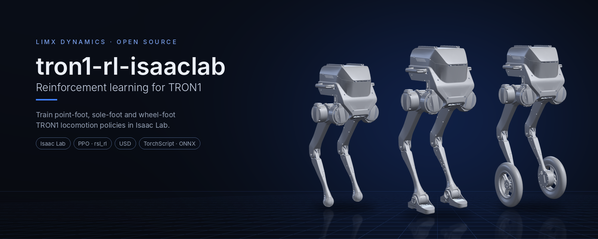
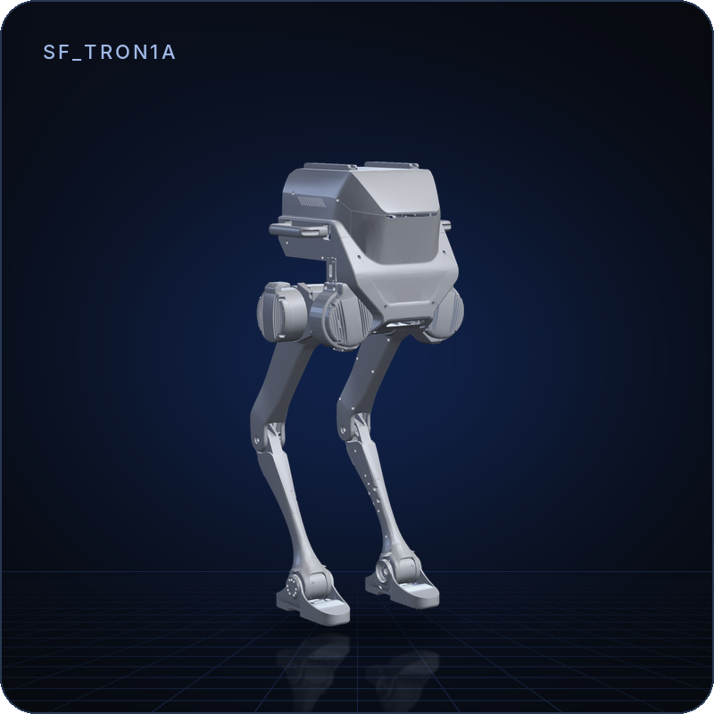
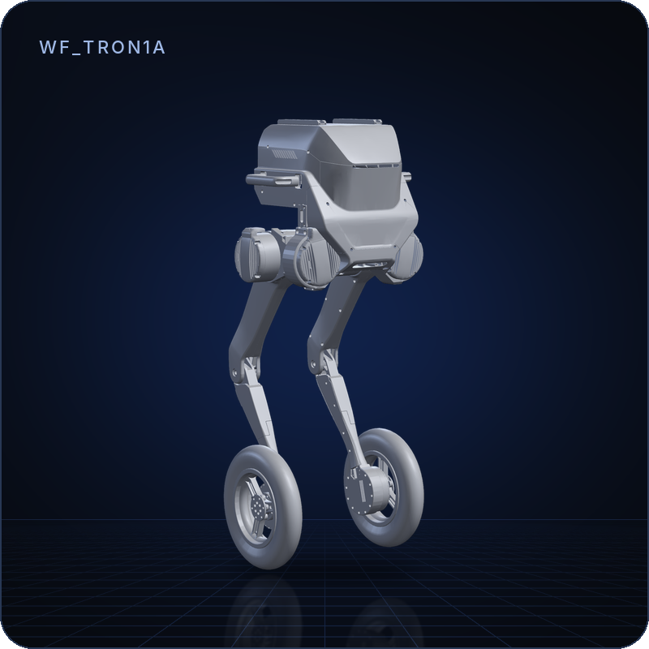
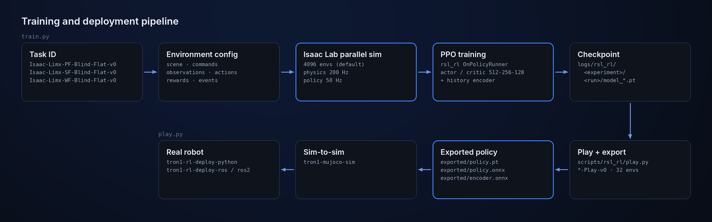
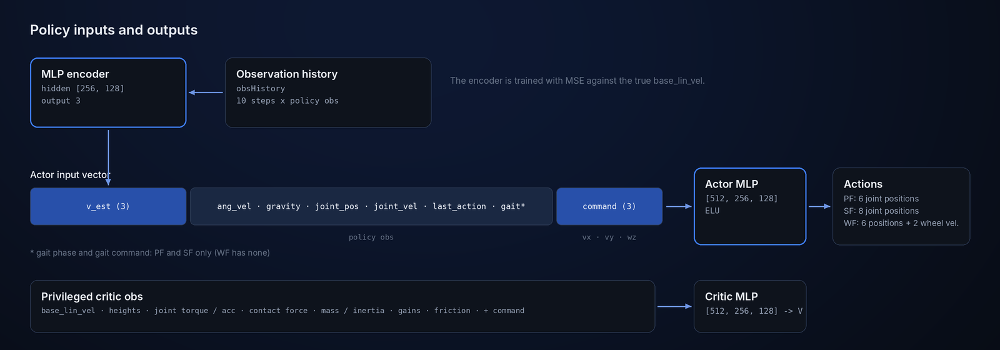

<p align="center">
  
</p>

<p align="center">
  <b>English</b> | <a href="README_cn.md">中文</a>
</p>

<p align="center">
  <a href="LICENCE"></a>
  
  
  
</p>

# tron1-rl-isaaclab

Reinforcement learning training stack for the LimX **TRON1** bipedal robot, built on [Isaac Lab](https://isaac-sim.github.io/IsaacLab/) and using PPO to train locomotion policies. This repository extends the Isaac Lab template to support sim-to-real training for TRON1 robot variants.

> **Scope:** blind (no perception) velocity tracking on flat ground for the
> point-foot, sole-foot and wheel-foot TRON1. No trained policies are
> included; pre-trained ones ship with
> [tron1-rl-deploy-python](https://github.com/limxdynamics/tron1-rl-deploy-python).

> **Part of the TRON1 open-source ecosystem.** All TRON1 repositories and where to start: [TRON1 open-source ecosystem](https://github.com/limxdynamics/tron1-rl-isaacgym#tron1-open-source-ecosystem).

## Highlights

- **Three TRON1 morphologies.** Point-foot (PF), sole-foot (SF) and
  wheel-foot (WF), each with a training task and a `-Play-v0` task.
- **Models included.** The USD assets for all three are bundled; nothing
  else to download.
- **Built-in velocity estimator.** An MLP encoder reads 10 steps of
  observation history and estimates base linear velocity, trained against
  the simulator's ground truth.
- **Privileged critic.** The critic also sees terrain heights, contact
  forces, mass, inertia, joint gains and friction, which exist only in
  simulation.
- **Ready to deploy.** `play.py` exports TorchScript (`policy.pt`) and ONNX
  (`policy.onnx`, `encoder.onnx`) for the TRON1 deployment repositories.

## Model lineup

| | Model | Description | DoF | Formats |
|:---:|---|---|:---:|---|
|  | **PF_TRON1A** | Point foot. 6 position actions (abad, hip, knee per leg).<br>`Isaac-Limx-PF-Blind-Flat-v0` | 6 | USD |
|  | **SF_TRON1A** | Sole foot with ankle pitch. 8 position actions.<br>`Isaac-Limx-SF-Blind-Flat-v0` | 8 | USD |
|  | **WF_TRON1A** | Wheel foot. 6 leg position actions + 2 wheel velocity actions.<br>`Isaac-Limx-WF-Blind-Flat-v0` | 8 | USD |

Rendered from the USD files in
`exts/bipedal_locomotion/bipedal_locomotion/assets/usd/`, in their authored
pose, with one camera and light setup. URDF and MJCF versions live in
[tron1-robot-description](https://github.com/limxdynamics/tron1-robot-description).

## How it works

<p align="center">
  
</p>

A task ID selects an environment config and a PPO config. Isaac Lab steps
thousands of environments in parallel (physics at 200 Hz, policy at 50 Hz),
`rsl_rl` trains the policy, and `play.py` exports it for sim-to-sim checks
in [tron1-mujoco-sim](https://github.com/limxdynamics/tron1-mujoco-sim) and
for deployment on the robot.

<p align="center">
  
</p>

## Quick start

With Isaac Sim and Isaac Lab installed:

```bash
git clone https://github.com/limxdynamics/tron1-rl-isaaclab.git
cd tron1-rl-isaaclab
pip install -e exts/bipedal_locomotion && pip install -e rsl_rl
python scripts/rsl_rl/train.py --task Isaac-Limx-SF-Blind-Flat-v0 --num_envs 4096 --headless
python scripts/rsl_rl/play.py --task Isaac-Limx-SF-Blind-Flat-Play-v0
```

## Requirements

- Isaac Sim + Isaac Lab, with isaaclab / isaaclab_tasks / isaaclab_rl importable
- Python 3.10
- GPU (>= 12 GB VRAM recommended for multi-env training)

## Installation

```bash
# 1. Clone the repository
git clone https://github.com/limxdynamics/tron1-rl-isaaclab.git
cd tron1-rl-isaaclab

# 2. Editable install of the extension and vendored rsl_rl
pip install -e exts/bipedal_locomotion
pip install -e rsl_rl
```

> **Note:** Robot model assets (USD files) for PF_TRON1A, SF_TRON1A and WF_TRON1A are bundled inside `exts/bipedal_locomotion/bipedal_locomotion/assets/usd/`. No additional model download is required.

## Training

Task IDs are registered in
[exts/bipedal_locomotion/bipedal_locomotion/tasks/locomotion/robots/__init__.py](exts/bipedal_locomotion/bipedal_locomotion/tasks/locomotion/robots/__init__.py).

```bash
# Pointfoot (PF)
python scripts/rsl_rl/train.py --task Isaac-Limx-PF-Blind-Flat-v0 --num_envs 4096 --headless

# Solefoot (SF)
python scripts/rsl_rl/train.py --task Isaac-Limx-SF-Blind-Flat-v0 --num_envs 4096 --headless

# Wheelfoot (WF)
python scripts/rsl_rl/train.py --task Isaac-Limx-WF-Blind-Flat-v0 --num_envs 4096 --headless
```

Common options:
- --resume True --checkpoint_path <path> -- resume from a specific .pt checkpoint (`--resume True` is required)
- --video -- enable video recording
- --max_iterations N -- override the maximum iteration count

Log path: logs/rsl_rl/<experiment_name>/<timestamp>_<run_name>/

## Play and export

Use the task ID with the `-Play-v0` suffix (32 environments). The latest
checkpoint is loaded unless `--checkpoint_path` is given, and the policy is
exported to an `exported/` folder next to it: `policy.pt` (TorchScript),
`policy.onnx` and `encoder.onnx`.

```bash
python scripts/rsl_rl/play.py --task Isaac-Limx-PF-Blind-Flat-Play-v0
python scripts/rsl_rl/play.py --task Isaac-Limx-SF-Blind-Flat-Play-v0
python scripts/rsl_rl/play.py --task Isaac-Limx-WF-Blind-Flat-Play-v0
```

## Robot Morphologies

| Morphology | End-effector | Policy actions | Task ID Prefix |
|---|---|---:|---|
| PF_TRON1A | point foot | 6 | Isaac-Limx-PF-... |
| SF_TRON1A | sole foot (ankle pitch) | 8 | Isaac-Limx-SF-... |
| WF_TRON1A | wheel | 8 | Isaac-Limx-WF-... |

## Related Repositories

| Repository | Description |
|---|---|
| [tron1-robot-description](https://github.com/limxdynamics/tron1-robot-description) | TRON1 robot model files |
| [tron1-rl-isaacgym](https://github.com/limxdynamics/tron1-rl-isaacgym) | TRON1 RL training with Isaac Gym |
| [tron1-mujoco-sim](https://github.com/limxdynamics/tron1-mujoco-sim) | TRON1 MuJoCo simulator for sim-to-sim validation |
| [tron1-rl-deploy-ros](https://github.com/limxdynamics/tron1-rl-deploy-ros) | TRON1 RL deployment (ROS) |
| [tron1-rl-deploy-ros2](https://github.com/limxdynamics/tron1-rl-deploy-ros2) | TRON1 RL deployment (ROS 2) |
| [tron1-rl-deploy-python](https://github.com/limxdynamics/tron1-rl-deploy-python) | TRON1 RL deployment (Python) |

## License

[Apache 2.0](LICENCE).
