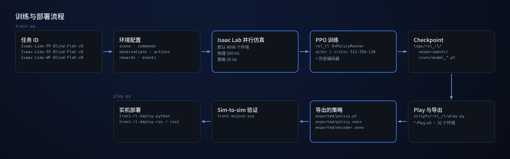
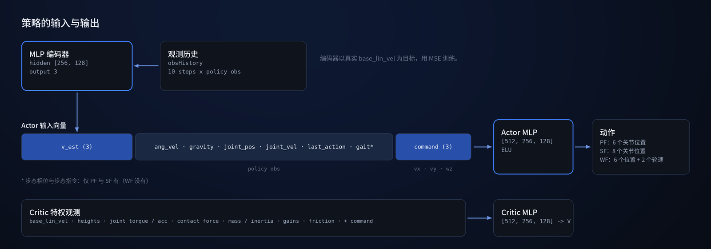

<p align="center">
  
</p>

<p align="center">
  <a href="README.md">English</a> | <b>中文</b>
</p>

<p align="center">
  <a href="LICENCE"></a>
  
  
  
</p>

# tron1-rl-isaaclab

基于 [Isaac Lab](https://isaac-sim.github.io/IsaacLab/) 的 LimX **TRON1** 双足机器人强化学习训练栈，使用 PPO 训练 locomotion 策略。本仓库扩展了 Isaac Lab 模板，支持 TRON1 机器人变体的 Sim-to-Real 训练。

> **适用范围：** 点足、掌足、轮足 TRON1 在平地上的无感知（Blind）速度跟踪。
> 仓库不附带训练好的策略；预训练策略随
> [tron1-rl-deploy-python](https://github.com/limxdynamics/tron1-rl-deploy-python) 提供。

> **TRON1 开源生态的一部分。** TRON1 全部开源仓库和上手路线：[TRON1 开源生态](https://github.com/limxdynamics/tron1-rl-isaacgym/blob/master/README_cn.md#tron1-开源生态)。

## 亮点

- **三种 TRON1 形态。** 点足（PF）、掌足（SF）、轮足（WF），各自注册了训练任务和 `-Play-v0` 任务。
- **模型随仓提供。** 三种形态的 USD 资产都已内置，无需额外下载。
- **内置速度估计器。** MLP 编码器读取 10 步观测历史，估计机身线速度，并以仿真真值为监督训练。
- **特权 Critic。** Critic 额外获得地形高度、接触力、质量、惯量、关节增益和摩擦等只在仿真中才有的信息。
- **导出即可部署。** `play.py` 导出 TorchScript（`policy.pt`）和 ONNX（`policy.onnx`、`encoder.onnx`），供 TRON1 部署仓库使用。

## 型号一览

| | 型号 | 说明 | 自由度 | 格式 |
|:---:|---|---|:---:|---|
|  | **PF_TRON1A** | 点足。6 维位置动作（每条腿 abad、hip、knee）。<br>`Isaac-Limx-PF-Blind-Flat-v0` | 6 | USD |
|  | **SF_TRON1A** | 掌足，带踝关节 pitch。8 维位置动作。<br>`Isaac-Limx-SF-Blind-Flat-v0` | 8 | USD |
|  | **WF_TRON1A** | 轮足。6 维腿部位置动作 + 2 维轮速动作。<br>`Isaac-Limx-WF-Blind-Flat-v0` | 8 | USD |

图片由 `exts/bipedal_locomotion/bipedal_locomotion/assets/usd/` 中的 USD 文件按原始姿态渲染，三者使用相同的相机和灯光。
URDF 与 MJCF 版本见 [tron1-robot-description](https://github.com/limxdynamics/tron1-robot-description)。

## 工作原理

<p align="center">
  
</p>

任务 ID 决定使用哪套环境配置和 PPO 配置。Isaac Lab 并行运行数千个环境（物理 200 Hz、策略 50 Hz），
`rsl_rl` 负责训练，`play.py` 导出策略，用于在
[tron1-mujoco-sim](https://github.com/limxdynamics/tron1-mujoco-sim) 中做 sim-to-sim 验证，以及实机部署。

<p align="center">
  
</p>

## 快速开始

已安装 Isaac Sim 与 Isaac Lab 时：

```bash
git clone https://github.com/limxdynamics/tron1-rl-isaaclab.git
cd tron1-rl-isaaclab
pip install -e exts/bipedal_locomotion && pip install -e rsl_rl
python scripts/rsl_rl/train.py --task Isaac-Limx-SF-Blind-Flat-v0 --num_envs 4096 --headless
python scripts/rsl_rl/play.py --task Isaac-Limx-SF-Blind-Flat-Play-v0
```

## 环境要求

- Isaac Sim + Isaac Lab，且 isaaclab / isaaclab_tasks / isaaclab_rl 可被 import
- Python 3.10
- GPU（推荐 >= 12 GB 显存，用于多环境训练）

## 安装

```bash
# 1. clone 仓库
git clone https://github.com/limxdynamics/tron1-rl-isaaclab.git
cd tron1-rl-isaaclab

# 2. editable install extension 与 vendored rsl_rl
pip install -e exts/bipedal_locomotion
pip install -e rsl_rl
```

> **说明：** 机器人模型资产（USD 文件）已内置在 `exts/bipedal_locomotion/bipedal_locomotion/assets/usd/` 中，覆盖 PF_TRON1A、SF_TRON1A 和 WF_TRON1A 三种变体，无需额外下载模型文件。

## 训练

任务 ID 在
[exts/bipedal_locomotion/bipedal_locomotion/tasks/locomotion/robots/__init__.py](exts/bipedal_locomotion/bipedal_locomotion/tasks/locomotion/robots/__init__.py)
中注册。

```bash
# Pointfoot (PF)
python scripts/rsl_rl/train.py --task Isaac-Limx-PF-Blind-Flat-v0 --num_envs 4096 --headless

# Solefoot (SF)
python scripts/rsl_rl/train.py --task Isaac-Limx-SF-Blind-Flat-v0 --num_envs 4096 --headless

# Wheelfoot (WF)
python scripts/rsl_rl/train.py --task Isaac-Limx-WF-Blind-Flat-v0 --num_envs 4096 --headless
```

常用选项：
- --resume True --checkpoint_path <path> -- 从指定的 .pt checkpoint 恢复训练（必须带 `--resume True`）
- --video -- 启用视频录制
- --max_iterations N -- 覆盖最大迭代次数

日志路径：logs/rsl_rl/<experiment_name>/<timestamp>_<run_name>/

## Play 与导出

使用带 `-Play-v0` 后缀的任务 ID（32 个环境）。未指定 `--checkpoint_path` 时加载最新的 checkpoint，
并把策略导出到它旁边的 `exported/` 目录：`policy.pt`（TorchScript）、`policy.onnx` 和 `encoder.onnx`。

```bash
python scripts/rsl_rl/play.py --task Isaac-Limx-PF-Blind-Flat-Play-v0
python scripts/rsl_rl/play.py --task Isaac-Limx-SF-Blind-Flat-Play-v0
python scripts/rsl_rl/play.py --task Isaac-Limx-WF-Blind-Flat-Play-v0
```

## 机器人形态

| 形态 | 末端 | 策略动作 | Task ID 前缀 |
|---|---|---:|---|
| PF_TRON1A | point foot | 6 | Isaac-Limx-PF-... |
| SF_TRON1A | sole foot (ankle pitch) | 8 | Isaac-Limx-SF-... |
| WF_TRON1A | wheel | 8 | Isaac-Limx-WF-... |

## 相关仓库

| 仓库 | 描述 |
|---|---|
| [tron1-robot-description](https://github.com/limxdynamics/tron1-robot-description) | TRON1 机器人模型文件 |
| [tron1-rl-isaacgym](https://github.com/limxdynamics/tron1-rl-isaacgym) | TRON1 Isaac Gym RL 训练 |
| [tron1-mujoco-sim](https://github.com/limxdynamics/tron1-mujoco-sim) | TRON1 MuJoCo 仿真器，用于 sim-to-sim 验证 |
| [tron1-rl-deploy-ros](https://github.com/limxdynamics/tron1-rl-deploy-ros) | TRON1 RL 部署（ROS） |
| [tron1-rl-deploy-ros2](https://github.com/limxdynamics/tron1-rl-deploy-ros2) | TRON1 RL 部署（ROS 2） |
| [tron1-rl-deploy-python](https://github.com/limxdynamics/tron1-rl-deploy-python) | TRON1 RL 部署（Python） |

## 许可证

[Apache 2.0](LICENCE)。
